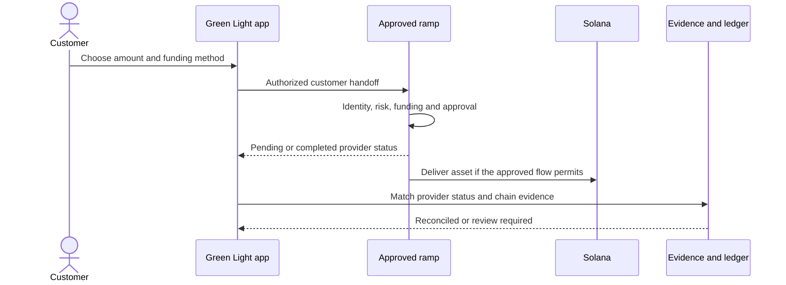
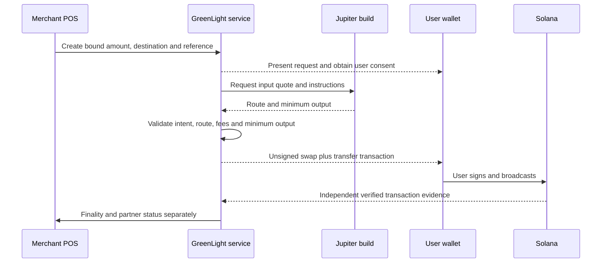

# Green Light Pay consumer sandbox and architecture starter

**Prepared:** November 24, 2026  
**Status:** Live read-only Phantom/Solflare wallet connection plus a fictional payment demonstration and engineering reference. No real payments, purchases, funding, conversions, fiat providers or settlement are connected. No approval, license or compliance certification is claimed.

## Open the working demonstration

Open `GreenLight_Pay_Consumer_Demo.html` from an HTTPS host in Phantom or Solflare's built-in browser, or a desktop browser with the corresponding wallet extension installed. The wallet panel requests connection approval, reads the selected Solana address, and queries SOL, USDC and $POTIFY balances from the public mainnet RPC. It requests no signature or transaction and does not store the wallet address. RPC lookups need internet access and can fail or be rate-limited. Local file previews generally cannot inject a wallet; the hosted link is the usable route on iPhone. Do not put real customer information into the demo.

From Safari on an iPhone, open the HTTPS app, choose **Connect Phantom** or **Connect Solflare**, and the app attempts to open that page inside the selected wallet's browser. Then tap **Connect** and approve the request in the wallet. Alternatively, open the hosted address directly from the wallet's own browser. Only proceed if the wallet displays the expected domain; a wallet warning remains a real unresolved issue and should not be bypassed. On disconnect the page drops its wallet state and asks the provider to disconnect. The wallet may separately retain site permissions in its own settings.

The interface supports:

1. Enter a fictional USD amount with the keypad, choose a fictional funding asset and send to a demo handle.
2. Open **Assets** and add fictional cash using an Apple Pay, debit or ACH label. No payment provider is opened.
3. Open **Shop** and buy a fictional POTIFY product with a selected demo asset. Inventory and Printify are not connected.
4. Open **Merchant** to see a fictional $42 request. The text sample `GLP-DEMO:4200` can be entered from **Pay QR**. The displayed request tile is not a scannable QR code; camera scanning and real Solana Pay are not implemented.
5. Open **Activity** to inspect simulated payments and the balanced local journal. Reset the demo with the **?** button. Data persists in that browser when local storage is available; the live wallet connection is separate.

Live wallet balances are intentionally separate from every demo balance and transaction. Public keys, SOL and token balances are read-only; the app does not provide authenticated identity merely by connecting. `wallet-connection.js` is embedded verbatim in the standalone HTML. Run `node tests/wallet.test.cjs` and `node tests/demo.test.cjs` in this directory. These tests use mock wallet providers and mock RPC results; they do not establish a successful physical iPhone wallet connection or production suitability.

The demo conversion assumptions, not market quotes, are $1/USDC, $100/SOL and $0.001/POTIFY. A USD-keypad amount is converted to a fake amount of the selected asset. The simulated token decimals and balances are fixtures and do not represent on-chain $POTIFY or an actual USD bank balance.

## Recovered foundation and limitations

The November 22, 2026 weekly review records a public sandbox displaying Counter, Green Gate, Handoff, Watchers and Receipt, plus an app-reported sandbox ledger and audit status. It did not independently prove end-to-end settlement or source correctness. Earlier plans included QR receipts, dual verification, balanced ledger, four-way reconciliation, a hash-linked audit chain, authorization, access control and encrypted views. These requirements informed the product and interface. The present demo is a clean, independently written reconstruction, **not a byte-for-byte copy or fork of the inaccessible Replit code**.

A Replit app listing identified `Green Light Pay` at https://replit.com/@jonathanbabec5/Green-Light-Pay. Metadata alone does not establish that this is the same deployment covered by the weekly review. No source or database was inspected or duplicated. The old sandbox remains untouched. Recovered planned gaps and the previous $42.50 savings fixture are documented in the accompanying dossier.

## Consumer and payment architecture

The proposed interface can be implemented with a responsive Next.js/Tailwind web application and React Native client. Core components: `AmountPad`, `AssetSelector`, `RecipientPicker`, `QRScanner`, `MerchantBadge`, `PaymentReview`, `ActivityList`, `AssetCard`, `ProductCatalog`, `ReceiptView` and `MerchantConsole`. The server owns and binds the payment intent, merchant, amount, requested asset, policy, expiry and unique reference; a browser never declares its own payment successful. Merchant, cashier, customer, operational-review and compliance-disclosure views require independent server-side permissions and tenant isolation.

### Planned funding sequence

Availability, method, reversal liability, timing, fees and eligible business categories depend on written provider authorization. ACH/card approval and USDC delivery do not make fiat funding and on-chain settlement atomic.

### Planned QR swap and pay sequence

Swap plus USDC transfer is atomic only if both instructions fit and succeed in the same Solana transaction. The transfer amount cannot exceed the swap's guaranteed minimum output; otherwise fail and re-quote. It must not silently draw a shortfall from existing USDC. A later fiat redemption, bank payout, chargeback or refund is a separate process. No route, stablecoin peg, instant cash settlement or fee can be guaranteed. User confirmation must show exact asset, amount, destination, rate, fees, expiry and risks.

### Example technical lifecycle

`DRAFT -> QUOTING -> REVIEW -> AWAITING_SIGNATURE -> SUBMITTED -> CHAIN_FINALIZED -> PARTNER_ACCEPTED -> RECONCILED`, with `EXPIRED`, `FAILED`, `CANCELLED` and `REVIEW_REQUIRED` as explicit branches. Chain finality is distinct from bank settlement, fulfillment and partner acceptance. An observer must validate signature, success, correct chain, amount, mint, token program, source, authority, destination, reference and finality. Compare independent observations, then match the merchant order, authorization/chain evidence, partner statement and internal balanced journal. A disagreement goes to review; a client click, a webhook alone or a blockchain signature alone is not settlement.

Use an append-only hash-linked audit record and independently export/anchor its head. Hashing does not prove that the data were true or that the system is immutable. Design encrypted customer and merchant views, expiring/rotating capabilities, least privilege, recovery, key separation and audit access. Do not place names, health information, basket contents or authorization tokens in public chain memos or URLs.

## TypeScript implementation reference

`nextjs-reference/` includes a Next.js/Tailwind keypad and two intentionally disabled API routes. `lib/jupiter-compose.ts` shows Jupiter Swap V2 `/build`, checked minimum output, server-bound values, unsigned Solana v0 composition, an associated USDC account, Solana Pay-style public reference, fee/rent considerations and RPC simulation. It requires an independently implemented `RequiredPolicy` for authenticated intents and security review of each returned instruction. It is not wired to a production server. `lib/payment-watcher.ts` shows finalized transaction checking and a callback to durable evidence storage; it is not running as a worker. `lib/provider-webhook.ts` demonstrates a generic HMAC pattern; real providers have different signing rules.

The payment routes return HTTP 503 by design. Authentication, server-side trusted orders, chain identity, durable database, merchant registry, KYC/KYB, authorization, sanctions, product restrictions, provider permission, token verification, complete instruction allowlisting, secure wallet signing and duplicate/replay protection must exist and be reviewed before a real endpoint can be enabled. Apart from the read-only wallet panel, this sample does not implement custody, customer key storage, a real quote endpoint, a broadcast endpoint, a live websocket, or real-time notifications. It does not claim an app-generated private key, a backend wallet or an MPC setup is automatically non-custodial.

If approved for development on a suitable computer, `cd nextjs-reference && npm install && npm run dev`; dependency installation and the Next.js build have not been run in this environment. The standalone HTML demo is separate from this reference.

## Practical work notes

- **Separate the products:** GreenLight is a proposed payment infrastructure concept; POTIFY is a community ecosystem. The optional token payment proposal is subject to separate counsel, issuer and provider decisions and does not create equity, revenue rights or guaranteed utility.
- **Wallets:** Embedded/social wallets and external Phantom/Solflare are proposals. Obtain each provider's exact signing, recovery, control and export model. The user must approve each real signature; never ask for seed phrases.
- **Funding:** Named ramp examples are candidates for assessment, not approved partners. Stripe, MoonPay, Transak and USDC issuer terms have material restrictions affecting some proposed categories. Do not conceal or route around an excluded activity.
- **KYC tiers:** Actual thresholds and escalation depend on applicable law, jurisdiction, risks and the regulated partner's program. Avoid inventing universal thresholds or equating a wallet with verified identity.
- **Token safety:** The requested POTIFY mint is `GWdHGomLjqofUSrj3TEhinr2UaRJMzJ5o7MRZLaFpump`; verify its owner program, decimals, authorities, liquidity, route, tax effects, price impact and Token-2022 extensions before use.
- **Savings example:** $42.50 sale, $1.53 comparator, $0.43 modeled eligible cost, $1.10 difference, split $0.50 consumer/$0.60 merchant/$0 network; the consumer amount due is $42.00. The original field labels are ambiguous and require accounting/commercial review. These numbers are illustrative and do not appear as promised savings in the demo.
- **Before launch:** Recover the exact Replit source and sanitized test evidence; have legal/compliance professionals classify every flow; obtain written bank, issuer, ramp, card, merchant and processor acceptance for the exact use; build and independently test durable ledger, reconciliation, security, privacy, access controls, error handling and operational support. A non-custodial label or an MPC provider does not eliminate money-transmitter analysis.

See the PDF handoff for the full recovery record, risk register, primary government sources, partner restrictions and ordered build plan.
